# ey-skills

Open-source skill definitions for AI coding agents.

## Skills

### `/todo` — Persistent Task Management

A markdown-based TODO system that the AI agent maintains for you.
Designed for people who've tried every TODO app and given up.

**How it works:**
- Tasks live in `~/.todo/TODO.md` — one flat file, always
- Agent reads it every session, surfaces what matters
- Completed tasks auto-archive to `DONE.md` and quarterly files
- Built-in staleness detection, reorg, and priority management
- Zero maintenance from the user — the agent does the bookkeeping

**Quick start:** Copy `todo/SKILL.md` into your agent's skill/instruction set.
The agent will initialize `~/.todo/` on first run.

See [`todo/SKILL.md`](todo/SKILL.md) for the full specification.

### `notepad` — AI Note Enhancement

A Granola-style notepad. You type scrappy, fragmentary notes; the agent turns
them into structured, polished notes while preserving every word you wrote
verbatim in a `## Raw` block.

**How it works:**
- On first use, the agent asks where to store notes — an existing Obsidian
  vault, any folder you choose, or a default (`~/Documents/notepad-ai`)
- The choice is remembered in `~/.config/ai-notepad/config` — no hardcoded paths
- One markdown file per note, catalogued in `INDEX.md` (newest-first, capped)
- Optional transcript merging: anchors define what you cared about, the
  transcript fills in the detail you didn't write down
- Works with plain markdown anywhere; uses Obsidian wikilinks/callouts/Bases
  when the backend is a vault

**Quick start:** Copy `notepad/SKILL.md` (and `notepad/templates/`) into your
agent's skill set. The agent runs first-run setup the first time you save a note.

See [`notepad/SKILL.md`](notepad/SKILL.md) for the full specification.

### `trip-companion` — A Page for Your Trip

Turns a trip (honeymoon, family holiday, friends' weekend, solo journey) into one phone-first page that the
travellers keep open the whole way: every booking, what is happening today, and a journey that is nice to scroll.
The agent interviews you, you pick a look, and it builds and publishes a single-file HTML Artifact.

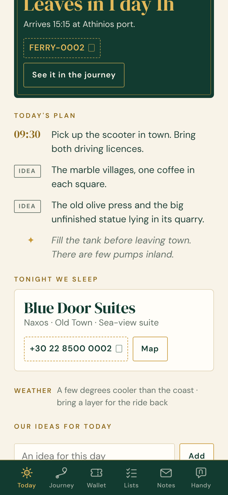
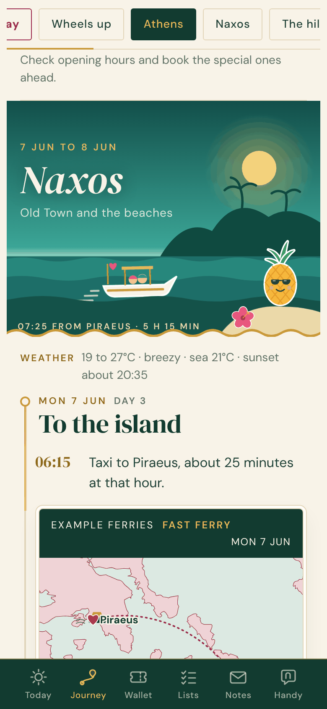
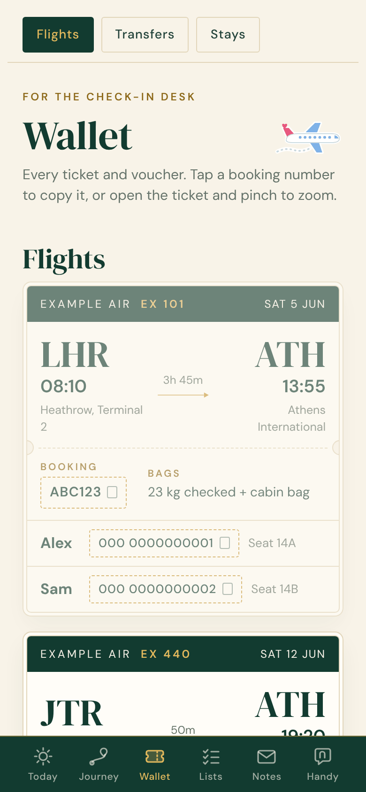
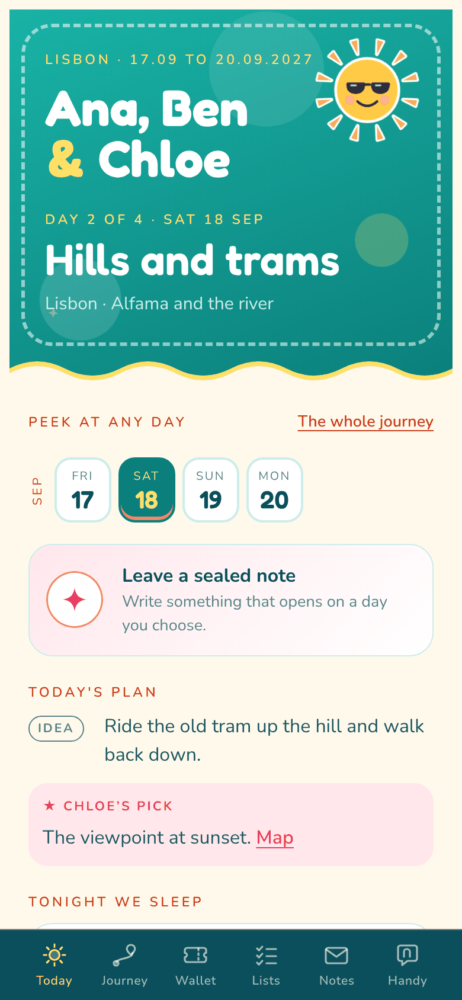

**How it works:**
- The agent asks in short rounds and takes whatever you have: confirmation emails, PDFs, screenshots
- Facts only — nothing is invented; what is unknown shows as "To confirm" and becomes a to-do
- Six views: Today, Journey, Wallet, Lists, Notes, Handy (taxi cards, phrases, money converter)
- **Secrets** — hidden surprises and sealed letters that open on their day, with a private list for whoever asked
- **Animation** — illustrated scenes that move as you scroll, travellers on route maps, stickers that react to taps (no games)
- **Together** — ticks, lists and sealed notes sync between the travellers' phones
- A `romance` setting: hearts and love-letter wording for a couple, or stars and plain wording for family and friends
- Built from one trip data file by a small Python script (standard library only)

**Pick a look.** Eight themes; the same page in each:

| | | | |
|:---:|:---:|:---:|:---:|
| 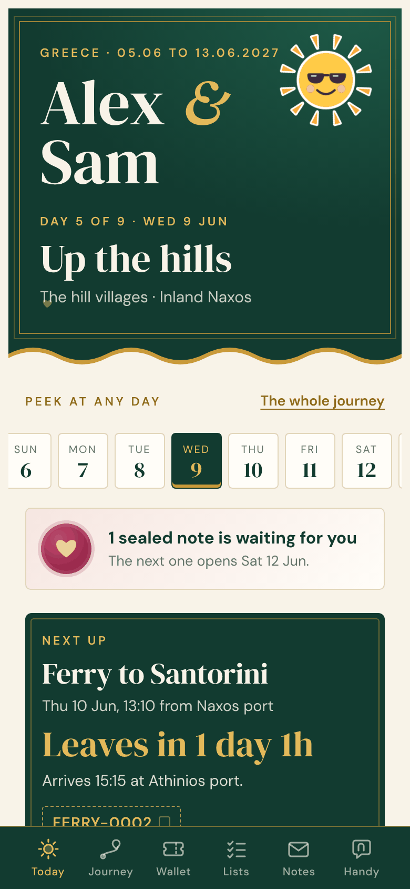 | 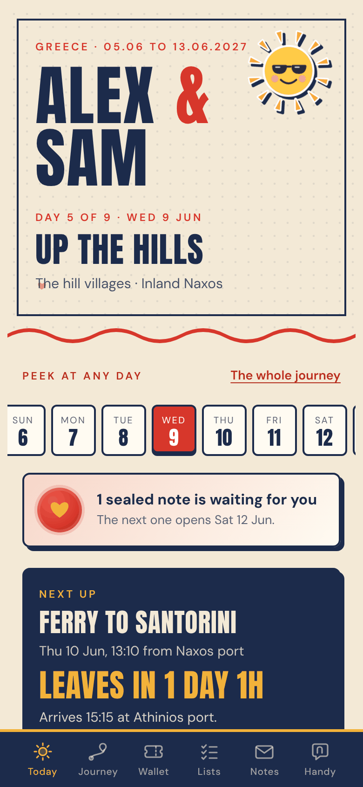 | 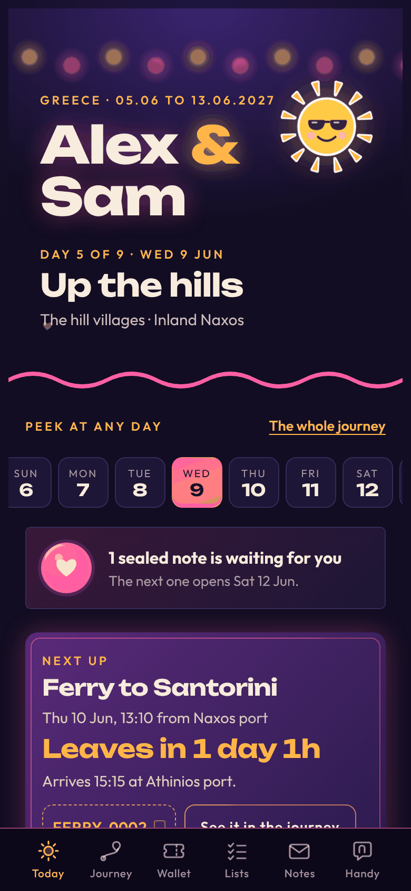 | 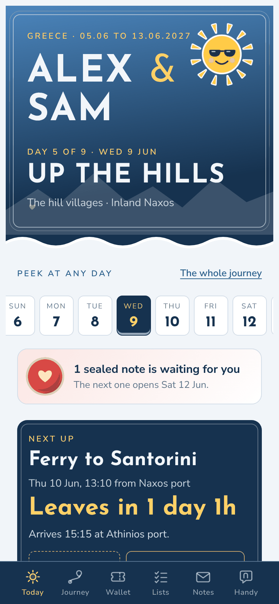 |
| **Silk and gold** (`silk`) Emerald silk, gold thread, ivory paper. Elegant and warm. | **Postcard** (`postcard`) Cream, navy and tomato red. Bold and cheerful. | **Night market** (`night`) Violet night, lanterns, neon glows. Lively. | **Alpine** (`alpine`) Snow, glacier blue, a red jacket. Crisp. |
| 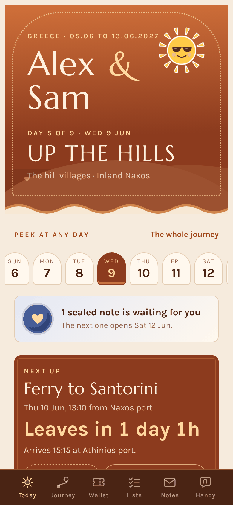 | 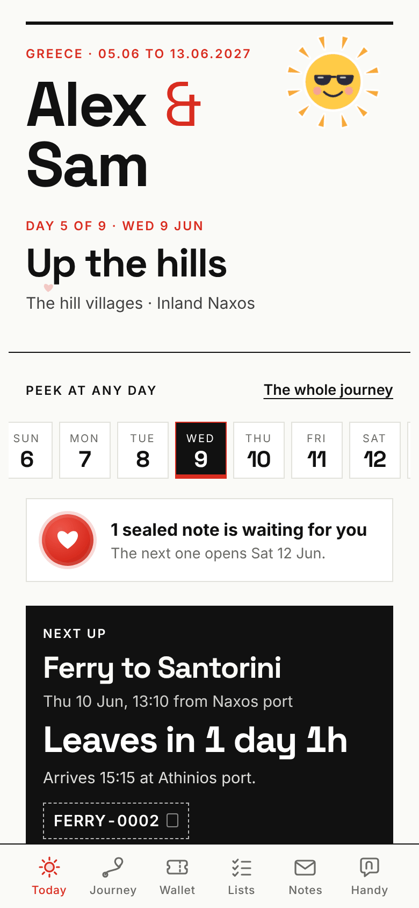 | 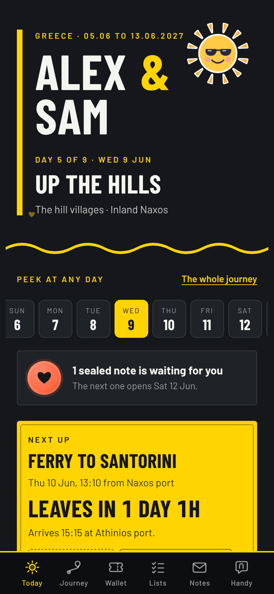 | 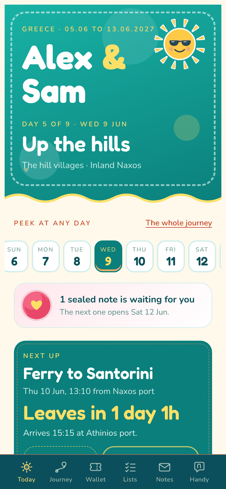 |
| **Desert** (`desert`) Terracotta, sand, a streak of indigo. Calm. | **Paper** (`paper`) White paper, black ink, one red pen. Minimal. | **Metro** (`metro`) Graphite and signal yellow. Sharp and urban. | **Lagoon** (`lagoon`) Turquoise, coral, sunshine. Playful. |

All pictures are from the invented example trips in `trip-companion/examples/`.

**Quick start:** Copy the `trip-companion/` folder into your agent's skill set and ask for "a page for our trip".
To see it without an agent: `python3 trip-companion/templates/build.py trip-companion/examples/greece/trip.py`.

See [`trip-companion/SKILL.md`](trip-companion/SKILL.md) for the workflow and
[`trip-companion/references/themes.md`](trip-companion/references/themes.md) for the themes.

## Philosophy

These skills follow a few principles:

1. **Zero friction** — if the user has to remember to do something, the system has failed
2. **Flat files** — markdown that works with grep, git, and any editor
3. **Agent-maintained** — the AI does the bookkeeping, the human does the thinking
4. **Bounded growth** — every file has a cap, archives are automatic
5. **Grep-friendly** — consistent tokens (`[P0]`, `T-042`, `[x]`) that tools can find

## License

MIT
