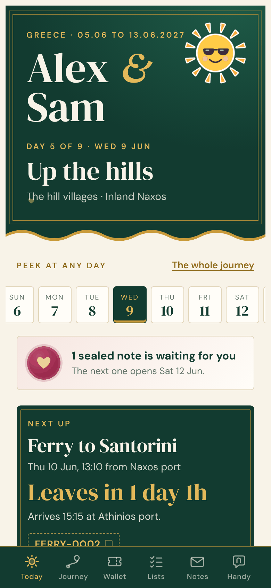
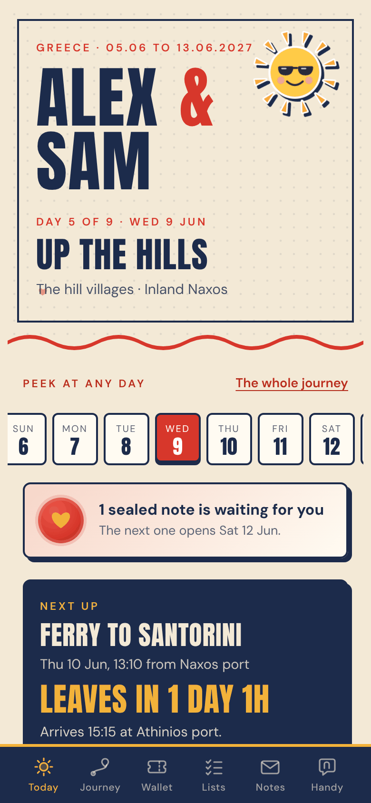
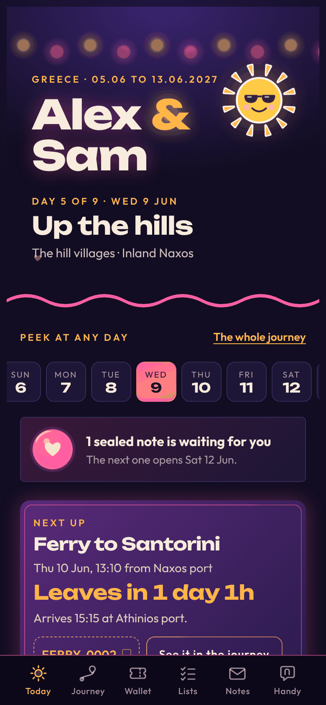
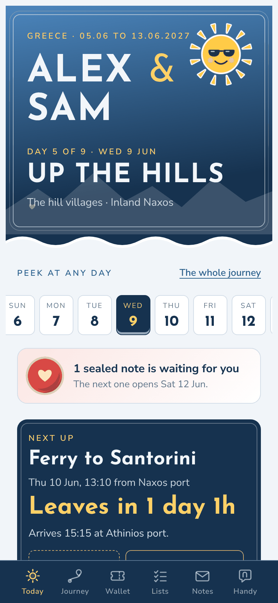
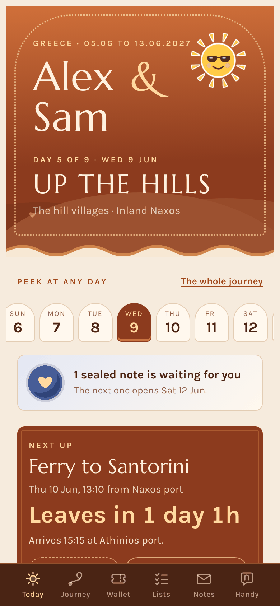
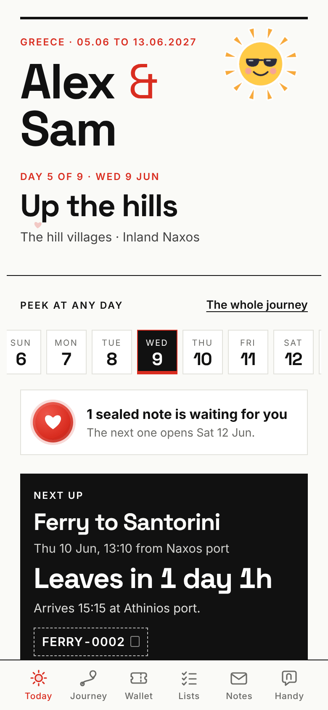
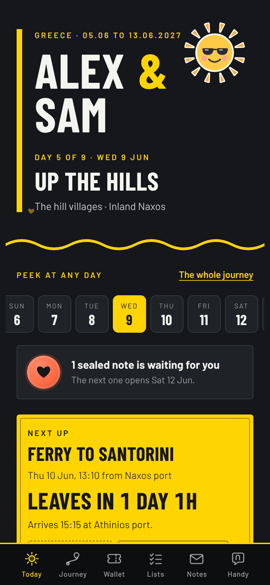
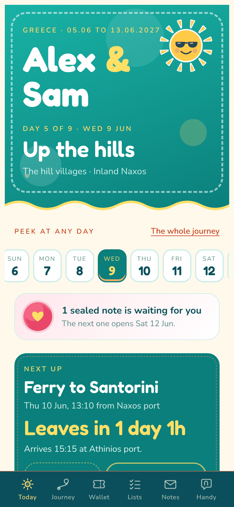

# Themes

Eight looks. A theme changes colours, fonts, card shapes and the colours of the scenes; it never changes what the
page does. Set it with `theme="..."` in `TRIP`, or try one without editing the trip file:

```sh
python3 templates/build.py trip.py --theme postcard
python3 templates/build.py --themes          # list them
```

Show the travellers the pictures below (they are in `previews/`, taken from the invented example trip) and offer
your pick with one reason. All pictures show the same Today screen.

| `theme` | name | mood | good for | picture |
|---|---|---|---|---|
| `silk` | Silk and gold | Emerald silk, gold thread and ivory paper. Elegant and warm; follows the phone's light or dark mode. | honeymoons, anniversaries, anything dressed up |  |
| `postcard` | Postcard | Cream paper, navy ink and tomato red. Bold condensed capitals and sticker cards with hard shadows; loud and cheerful. | summer holidays, road trips |  |
| `night` | Night market | Deep violet night, lantern garlands, neon pink and mango glows. Dark, lively, a little loud. | city breaks, food trips, night owls |  |
| `alpine` | Alpine | Fresh snow, glacier blue and a red ski jacket. Crisp, cool and outdoorsy, with geometric poster lettering. | mountains, skiing, hiking, the north |  |
| `desert` | Desert | Terracotta, warm sand and a streak of indigo. Sun-baked and calm, with classical Roman lettering. | deserts, old cities, slow warm trips |  |
| `paper` | Paper | White paper, black ink and one red pen. Minimal, square and quiet; the drawings carry the colour. | people who want it plain; work trips with a free weekend |  |
| `metro` | Metro | Graphite night and signal yellow, like station signage. Dark, sharp and urban, in condensed capitals. | big cities, rail trips |  |
| `lagoon` | Lagoon | Turquoise water, coral and sunshine yellow. Round, bouncy and playful; good for families and beach trips. | families, friends, beach weeks |  |

More of the page: [Today during the trip](../previews/page-today.png), [a journey scene](../previews/page-journey.png),
[the wallet](../previews/page-wallet.png), and [the friends example with romance off](../previews/page-friends.png).

Notes for choosing:

- `silk` is the only theme with a light and a dark version (it follows the phone). `night` and `metro` are always
  dark; the others are always light.
- With `romance=True` the confetti is always pink and gold. With romance off it takes the theme's own colours.
- Stickers are independent of the theme: `TRIP["stickers"]` and the scene options (`references/scenes-and-art.md`).
- Theme fonts are Latin. For Greek, Japanese, Arabic and other scripts the taxi cards and phrases use the phone's
  own font, or the Google font named in `TRIP["local_font"]`.

## How a theme file works

`templates/themes/<name>.css` is appended after the page's base styles. It has a header comment the build reads,
one block of custom properties, and as few extra rules as possible.

```css
/* @name: Alpine
   @mood: One sentence a traveller can choose by.
   @fonts: family=Josefin+Sans:wght@400;600;700&family=Nunito+Sans:wght@400;500;600;700
   @scene: deep=#0D2238 dark=#16324F mid=#3F74A8 gold=#FFD166 gold2=#E8B04A ivory=#F2F6FA
   @confetti: #D03A3A #2F6690 #FFD166 #7FC8E8 #FFFFFF */
:root:root:root { --bg: ...; --surface: ...; ... }
```

- `@fonts` is the query string of a Google Fonts `css2` link. Leave it out to use system fonts only.
- `@scene` recolours the drawn scenes: `deep`/`dark`/`mid` are the night-sky and sea tones, `gold`/`gold2` the
  line and glow colour, `ivory` the light text and foam. Leave it out to keep the emerald and gold originals.
- `@confetti` is used when romance is off.
- `:root:root:root` is deliberate: it out-ranks the base theme's light and dark blocks without `!important`.

The main properties (all are listed at the top of `template.html`):

| property | paints |
|---|---|
| `--bg`, `--surface`, `--line` | page, cards, hairlines |
| `--ink`, `--text`, `--muted` | headings, body, small print |
| `--panel`, `--panel2`, `--on-panel`, `--hi` | the dark feature panels (hero, pass headers, "next up"), their text and highlight |
| `--accent`, `--accent-ink` | decorative accent, and the same hue dark enough for text and links |
| `--pop`, `--pop-soft` | the one loud colour (picks, alerts, seals) and its tint |
| `--bar`, `--on-bar`, `--bar-hi` | the bottom bar |
| `--hero-bg`, `--hero-ink`, `--hero-hi` | the top panel on Today, when it should differ from `--panel` |
| `--display`, `--body` | heading and body fonts |
| `--m-sea`, `--m-land`, `--m-edge`, `--m-dest`, `--m-home`, `--stop` | route maps |
| `--wax-a`, `--wax-b`, `--wax-c`, `--wax-mark` | the wax seal on sealed notes |
| `--c0` ... `--c5` | one colour per chapter (journey thread, nights strip) |
| `--shadow`, `--scrim` | shadow and overlay colours as `r g b` |

## Adding a theme

1. Copy the closest existing file. Change the header and the properties first; add rules only for what
   properties cannot say (letter case, card corners, a hard shadow).
2. Keep text contrast at 4.5:1 or better: `--text` on `--bg` and `--surface`, `--on-panel` on `--panel`,
   `--accent-ink` on `--bg`, `--on-bar` on `--bar`. Check numerals in the display font; some display faces draw
   digits that read badly at small sizes (the Desert theme sets numbers in its body font for that reason).
3. Build the Greece example with it and look at every view at phone width (`references/publishing.md`),
   including a pass, a sealed note, the phrase card full screen, a map and the bottom bar.
4. Make it its own look. Do not imitate a real brand, airline, app or transit system.
5. Add a preview picture to `previews/` and a row to the table above and to the gallery in the repository README.
